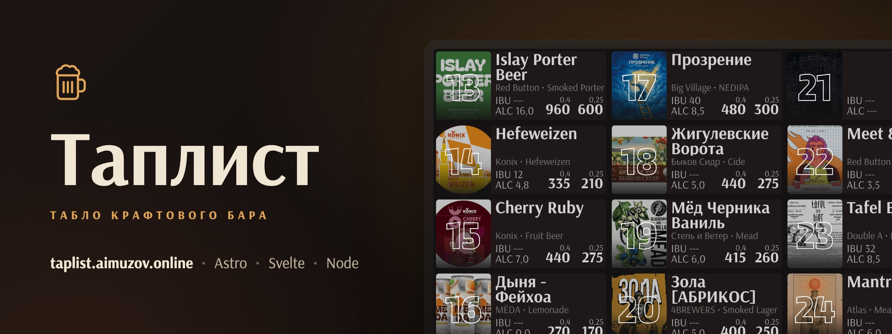
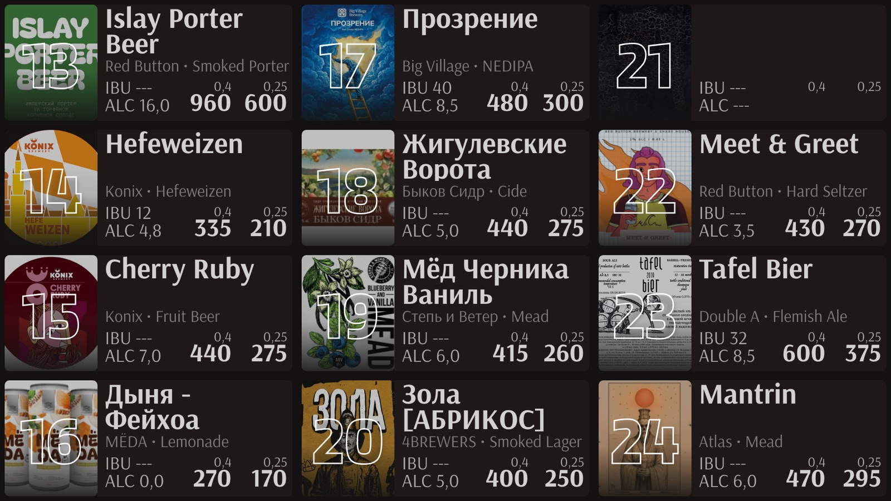
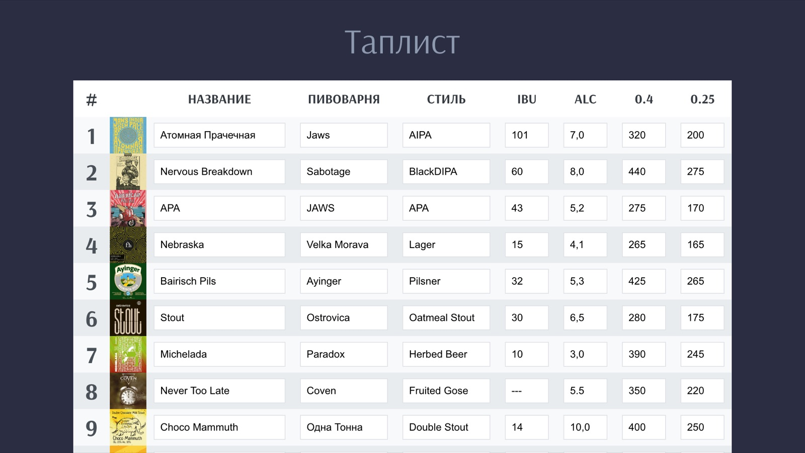

<p align="center">
	<a href="https://taplist.aimuzov.online"></a>
</p>

<p align="center">
	<a href="https://github.com/aimuzov-projects/community-taplist/actions/workflows/deploy.yml"></a>
	<a href="https://taplist.aimuzov.online"></a>
	<a href="package.json"></a>
	<a href="https://astro.build"></a>
	<a href="https://svelte.dev"></a>
	<a href="LICENSE"></a>
</p>

> 🇬🇧 [English](README.md) · 🇷🇺 **Русский**

<h3 align="center">Электронный таплист крафтового бара</h3>
<p align="center">Табло на телевизорах, редактор для барменов, список в GitHub Gist -- без базы данных</p>

<table>
	<tr>
		<td width="50%" align="center"><br><b>Табло</b> на телевизорах</td>
		<td width="50%" align="center"><br><b>Редактор</b> для барменов</td>
	</tr>
</table>

Живёт на [taplist.aimuzov.online](https://taplist.aimuzov.online). Статичный сайт на [Astro](https://astro.build) с островами на Svelte и маленький API (`src/backend/`) на Node без зависимостей: он читает и пишет gist и держит список в памяти, чтобы табло не упирались в лимиты GitHub.

## Что внутри

- **Выбор экрана** (`/`) -- с пульта: влево-вправо выбрать, OK открыть.
- **Табло** (`/tv/1`, `/tv/2`) -- 1920×1080, 12 кранов на экран. RETURN на пульте возвращает к выбору. Свежий список табло забирает на месте, без перезагрузки, а после деплоя один раз перезагружается само. 25-й кран чередуется с последним местом второго экрана.
- **Редактор** (`/editor`) -- названия, пивоварни, стили, IBU, крепость и цены, перестановка перетаскиванием, обложки (сжимаются в браузере до 250 px и хранятся прямо в gist).
- **API** -- `GET /api/items` для табло, `PUT /api/items` для редактора, `GET /api/health`.

## Запуск

Нужен Node 26.11.1, эта же версия закреплена в `package.json` и в Dockerfile.

```sh
cp .env.example .env   # можно оставить пустым: API отдаст пример таплиста
npm ci
npm run dev            # сайт, /api проксируется на localhost:8787
npm run api            # API
```

Перед коммитом:

```sh
npm run format:check && npm run lint:js && npm run lint:css && npm run check && npm test
```

### Gist

1. Создайте секретный gist с файлом, например `taplist.json`, и содержимым `{ "record": [] }`.
2. Создайте [fine-grained токен](https://github.com/settings/personal-access-tokens/new) только с правом **Gists: Read and write**.
3. Пропишите в `.env` токен, ID gist (конец его адреса) и имя файла, см. [`.env.example`](.env.example).

Редактор перезаписывает файл целиком. С `CACHE=1` правки, сделанные прямо в gist, появятся только после перезапуска API.

## Телевизоры

Табло открывается в браузере LG webOS 5, это Chromium 68. Поэтому:

- клиентская сборка опускает синтаксис до `chrome68` (плагин `client-target` в `astro.config.mjs`: сам Astro ставит клиенту `esnext`);
- `globalThis`, `queueMicrotask` и `String.prototype.replaceAll`, которых в нём нет, подставляет инлайн-скрипт в `src/frontend/layouts/base.astro`;
- в CSS без `gap` у flex и без `min()` вне `@supports`, без `Array.prototype.at` и прочего новее 2019 года в коде, который попадает в браузер.

Проверка бандла после сборки: `npx es-check es2019 'dist/_astro/*.js' --module`.

## Content Security Policy

Сборка кладёт в каждую страницу CSP с хешами скриптов и стилей Astro (`security.csp` в `astro.config.mjs`). В `npm run dev` политики нет, нарушения видны только в `npm run build && npm run preview` и на проде. Картинки разрешены с любого `https:`: обложки бывают ссылками на внешние сервисы.

## Выкладка

Пуш в `main` запускает GitHub Actions: сначала проверки, затем вход по SSH на сервер `projects`. Там ключ привязан к [`deploy/remote.sh`](deploy/remote.sh), который подтягивает `main` и пересобирает контейнеры из [`deploy/docker-compose.yml`](deploy/docker-compose.yml): nginx со статикой и API. Домен, TLS и пароль редактора (`basic_auth` на `/editor` и `PUT /api/items`) держит общий Caddy из `aimuzov-projects/infra-server`. `.env` лежит на сервере в `/srv/community-taplist`.

Откатить выкладку -- значит сделать `git revert` плохого коммита в `main` и запушить. `remote.sh` поднимает compose с `--remove-orphans`, так что контейнеры, которых в прежней версии не было, уходят сами.

## Лицензия

[MIT](LICENSE)
